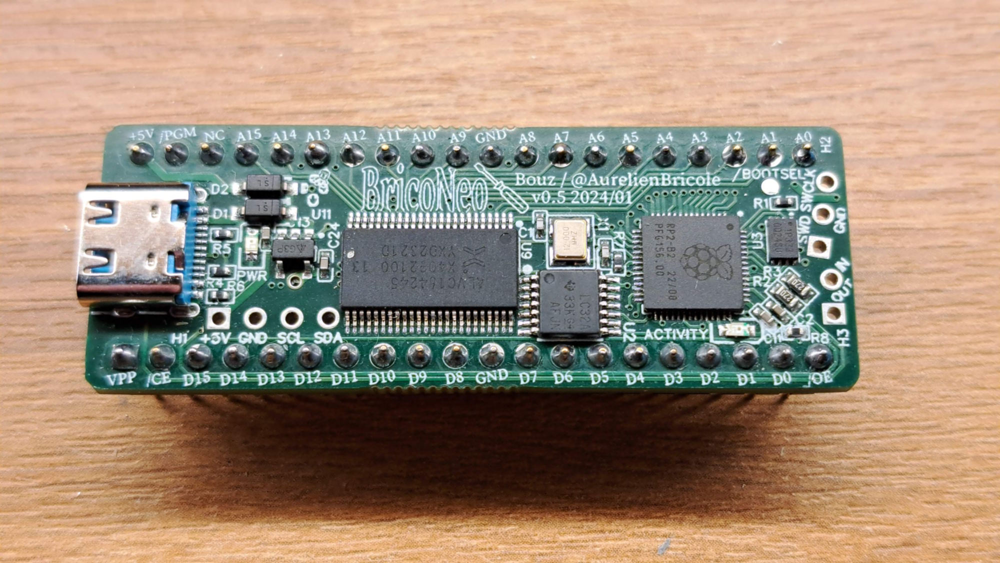
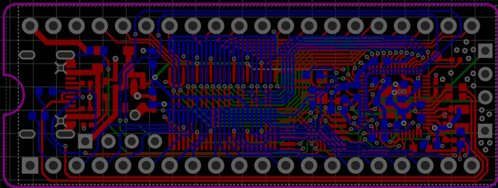
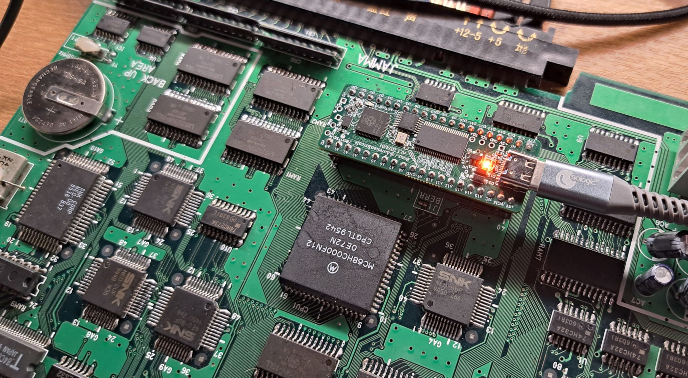
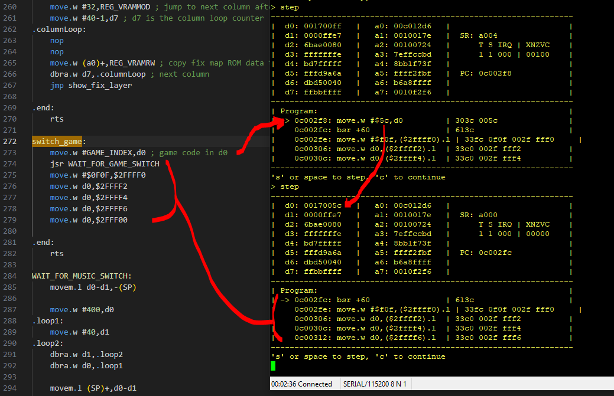
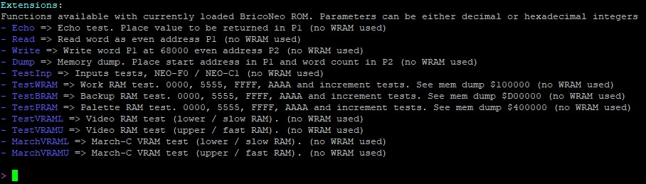

# BricoNeo

**BricoNeo** is a Raspberry Pi Pico (RP2040 / RP2354) based diagnostic tool for the **Neo Geo AES / MVS**. It plugs directly into the **SP1 socket** (the system program ROM, i.e. the BIOS) on the motherboard and behaves as that ROM towards the Neo Geo hardware, while giving you, on the PC side, a USB console to control it and inspect what's going on.

It was built to help repair and troubleshoot dead or misbehaving Neo Geo boards: swap BIOS/diagnostic images in seconds without an EPROM programmer, watch the address bus, measure clock signals, and even single-step the 68000 CPU live.

> Author: Bouz / [@AurelienBricole](https://www.youtube.com/@aurelienBricole)
You can ask any question here: [Delta Island forum](https://delta-island.com/briconeo)



## Table of contents

- [Features](#features)
- [Hardware overview](#hardware-overview)
- [Installing the board](#installing-the-board)
- [Connecting to the board](#connecting-to-the-board)
- [Using the serial console](#using-the-serial-console)
- [Command reference](#command-reference)
- [Loading ROM images via USB mass storage](#loading-rom-images-via-usb-mass-storage)
- [Loading ROM images via the ROM upload serial port](#loading-rom-images-via-the-rom-upload-serial-port)
- [Diagnostics: bus tracing, frequency counter, live 68000 debugger](#diagnostics-bus-tracing-frequency-counter-live-68000-debugger)
- [BricoExt: talking back from your own ROM](#bricoext-talking-back-from-your-own-rom)
- [Building the firmware](#building-the-firmware)
- [Project layout](#project-layout)
- [Some videos showing the board in action](#some-videos-showing-the-board-in-action)
- [License](#license)

## Features

- **EPROM emulation**: emulates the SP1 program ROM over the native address/data bus, using the RP2040/RP2354 PIO block / DMA so the Neo Geo sees a real ROM with no added wait states.
- **4 ROM banks** stored in the Pico's flash (128 KB each), any of which can be loaded into "live" RAM in a fraction of a second — no more re-flashing an EPROM to try another BIOS/diagnostic tool.
- **Triple USB personality**: the board enumerates as a USB-CDC serial console, a second USB-CDC serial port dedicated to ROM uploads and a USB mass-storage drive at the same time to make ROM uploads easier.
- **Drag & drop ROM loading**: drop a `.BIN` file on the BricoNeo USB drive to flash it straight to a bank.
- **Interactive command-line console** for ROM management, raw bus reads, tracing, and system control + diagnostic commands using a special diag ROM.
- **Bus address tracer**: records the addresses accessed by the Neo Geo in a ring buffer for later inspection — useful to see where a board's CPU gets stuck.
- **Frequency counter** on an extension input pin — handy to check clocks / sync signals on a suspect board.
- **Live 68000 debugger**: with a trace-enabled ROM, single-step 68k code and see all registers, the status flags and a live disassembly of the next instructions, frame by frame.
- **BricoExt extension protocol**: write your own diagnostic ROM that exposes custom commands, straight into the BricoNeo console (see [BricoExt](#bricoext-talking-back-from-your-own-rom)).
- **Firmware updates over USB** (`BootSel` command, standard RP2 UF2 drag-and-drop).

## Hardware overview

BricoNeo replaces the **SP1 (system program) ROM** on the Neo Geo motherboard: it sits in that socket and drives the address/data bus exactly like the EPROM it replaces.

- 16-bit data bus, matching the SP1 socket's word-wide EPROM.
- Currently supports 128 KB ROM images per bank (`FLASH_IMAGE_SIZE` in [`ROMImageManager.h`](ROMImageManager.h)), 4 banks available.
- Built around the RP2040 or RP2354 (Raspberry Pi Pico / Pico 2), overclocked to 200 MHz for reliable bus timings (see [`Brico16Bits.cpp`](Brico16Bits.cpp)).
- Bus access is entirely handled by the PIO state machines in [`PioBusAccess.pio`](PioBusAccess.pio) (ROM emulation), [`PioBusWatcherAddresses.pio`](PioBusWatcherAddresses.pio) / [`PioBusWatcherPort.pio`](PioBusWatcherPort.pio) (bus tracing) and [`PioFrequencyCounter.pio`](PioFrequencyCounter.pio) (frequency measurement), backed by DMA so the CPU cores stay free for the USB console.
- An extra input pin (`PIN_EXTENDED_IN`) and a slot-power sense pin (`PIN_SLOT_POWER`, wired from board revision v0.6) are available for diagnostics — see [`PinDefinitions.h`](PinDefinitions.h).
- An activity LED shows the board status (idle / terminal connected / data transfer) — see [`ActivityLED.h`](ActivityLED.h).




## Installing the board



1. **Power off** the Neo Geo system completely before touching anything.
2. Remove the original SP1 ROM from its socket (AES cartridge or MVS motherboard, depending on your setup).
3. Plug BricoNeo into the now-empty SP1 socket, **respecting pin 1 orientation**.
4. Power the console back on. With no bank loaded yet, BricoNeo defaults to bank 0 at boot (`FLASH_ROM_BANK_DEFAULT`).
5. Connect a USB cable from BricoNeo to your PC (see below).

## Connecting to the board

Plugging in the USB cable exposes **three USB devices** at once:

- A **serial (USB-CDC) console** (first serial port) — open it with any serial terminal (PuTTY, Tera Term, `screen`, CoolTerm, minicom...). The baud rate doesn't matter since it's a native USB-CDC connection.
- A **ROM upload serial port** (second serial port) — any data sent to it is loaded as a ROM image (see [below](#loading-rom-images-via-the-rom-upload-serial-port)).
- A **USB mass-storage drive** named `BricoNeo`, used to drag & drop ROM images (see below).

As soon as a terminal opens the serial port, BricoNeo prints its welcome banner: build date, board unique serial number, and (if a BricoNeo-aware ROM is currently loaded) its version and special mode flags, followed by the full command list.

## Using the serial console

A few conventions apply to every command you type at the `>` prompt:

| Prefix / key | Effect |
|---|---|
| `?` | Re-print the list of available commands |
| `*<command>` | Repeat the command in a loop until any key is pressed |
| `**<command>` | Same as above, but clears the screen and shows a loop counter on every refresh |
| `@<command>` | Request binary output instead of a formatted text result (where supported) |
| `;<comment>` | Comment line — ignored, useful when pasting a whole script into the terminal |
| Arrow Up/Down | Recall the previous command |

## Command reference

Commands are grouped in sections, exactly as shown by the `?` command:

### Miscellaneous
| Command | Parameters | Description |
|---|---|---|
| `BootSel` | | Reboot into USB bootloader mode to flash new firmware |
| `;` | `<text>` | Comment, ignored |
| `Delay` | `x` | Wait `x` milliseconds |
| `Dbg` | | Enter the live 68000 debugger (see [below](#diagnostics-bus-tracing-frequency-counter-live-68000-debugger)) |

### ROM images management
ROM images are stored in 4 flash banks; bank 0 is loaded automatically at startup.

| Command | Parameters | Description |
|---|---|---|
| `SendROMPart` | `bytes` | Upload `bytes` bytes of a ROM image; negative value auto-byteswaps |
| `LoadBank` | `x` | Load flash bank `x` into RAM (and resets the Neo Geo) |
| `StoreBank` | `x` | Store the current RAM image into flash bank `x` |
| `SetRomW` | `@addr word` | Patch a single word in the current ROM image at address `@addr` |
| `ListRoms` | | Dump the first bytes of the current image and of all 4 banks |

### BricoNeo buffer access
Words sent by the Neo Geo (68000 side) to BricoNeo land in an input ring buffer.

| Command | Parameters | Description |
|---|---|---|
| `ReadWord` | | Read one word from the buffer |
| `ReadWords` | | Read and dump the whole buffer |
| `ClearBuffer` | | Clear the buffer |

### System
| Command | Parameters | Description |
|---|---|---|
| `Trace` | `on`/`off` | Start/stop recording the addresses accessed on the bus into the buffer |
| `Free` | | Show available RAM on the BricoNeo board |
| `Freq` | | Measure the frequency (or logic level) on the extension input pin |
| `Ls` | | Directory listing of the embedded mass-storage filesystem |
| `Reset` | | Reset the Neo Geo board via the watchdog |

### Extensions (BricoExt)
Only shown when a BricoNeo-aware ROM is currently loaded — commands are entirely defined by that ROM (see [BricoExt](#bricoext-talking-back-from-your-own-rom)).

## Loading ROM images via USB mass storage

This is the easiest way to swap BIOS/diagnostic images. Works OK under Windows, but might be instable under MacOS/Linux (but it works!). The drive is "write-only". It is only used as a target to drop ROM files:

1. Open the `BricoNeo` USB drive on your computer.
2. Drag a raw `.BIN` ROM image (128 KB, same format as an SP1 dump, endianness is auto-detected) onto the appropriate bank slot.
3. BricoNeo detects the new file after a short debounce delay and programs it into the board. The drive briefly "ejects and re-injects" itself while it updates its virtual filesystem — this is expected, just let it finish.
4. The file should have disappeared from the drive
5. A file drop in the root folder is loaded in BricoNeo's RAM only. A file dropped in a bank is persisted. Bank0 is loaded at startup.

> This repository does **not** ship any ROM images — the local `ROM/` folder used during development (BIOS dumps, diagnostic tools, Unibios...) is intentionally excluded (see `.gitignore`). You need to supply your own dumps; make sure you're legally entitled to use them (e.g. dumps of hardware you own, or open-source tools such as [Universe BIOS](https://unibios.free.fr/) if licensed, [NeoDiag](https://wiki.neogeodev.org/index.php?title=Diagnostic_ROM)...).

## Loading ROM images via the ROM upload serial port

The second serial port is dedicated to ROM uploads, and behaves like a file dropped at the root of the mass-storage drive: the received data is loaded into BricoNeo's RAM, byteswapped if needed (auto-detected), and the Neo Geo is reset. Just redirect the raw `.BIN` file to the port from a shell:

```
copy /b UNIBIOS4.BIN COM6        (Windows)
cat UNIBIOS4.BIN > /dev/ttyACM1  (Linux)
cat UNIBIOS4.BIN > /dev/cu.usbmodemXXXX3  (macOS)
```

- The end of the transfer is detected when the host closes the port, or after 300 ms without data. Data beyond 128 KB is ignored.
- Data that doesn't look like a SP1 image (reset vector not pointing to `0xC0xxxx`, in either endianness) is ignored: this protects the current image against port probing by the OS or text typed by mistake.
- A file smaller than 128 KB only overwrites the beginning of the current image.
- If the port is still open at the end of the transfer, a status line is sent back (`OK 131072 bytes, byteswapped` or `ERROR ...`). A message is also printed on the console if a terminal is connected.
- The image goes to RAM only. To persist it, type `StoreBank x` on the console.

[`SendROMs.bat`](SendROMs.bat) shows how to pre-load several banks in one go on Windows, using both serial ports (adjust `CONSOLEPORT`, `ROMPORT` and `ROMPATH` first).

## Diagnostics: bus tracing, frequency counter, live 68000 debugger

- **`Trace on`** starts recording every address the Neo Geo requests on the bus into the input buffer (stops automatically once the buffer is full); `Trace off` reverts to normal buffer behaviour. Read the captured addresses back with `ReadWords`.
- **`Freq`** reads the frequency present on the extension input pin (or its logic level, below 100 Hz) — useful to check that a clock or sync signal is actually toggling on a suspect board.
- **`Dbg`** turns BricoNeo into a live 68000 debugger: it patches a conventional Neo Geo system ROM's TRACE interrupt vector (or expects a ROM that already declares one), resets the board, then shows, frame by frame, all data/address registers, the status register flags (T/S/IRQ/X/N/Z/V/C), the program counter and a short disassembly of the upcoming instructions. Press `s`/space to single-step, `c` to run to the next breakpoint/trace event, `x` to exit.



## BricoExt: talking back from your own ROM

BricoNeo can recognize a specially crafted ROM image and let its 68000 code talk back to the USB console — this is how the `Extensions` command section gets populated. The image exposes, at fixed offsets defined in [`MemoryMap.h`](MemoryMap.h):

- a magic word and a version number identifying it as a "BricoNeo ROM",
- special mode flags (e.g. enabling extensions, letting the 68k drive command execution, or automatic CRC/mirror computation for NeoDiag-style images),
- a table describing each custom command (name, description, result type, target address).

Helper routines for the 68000 side live in [`Commands68k/`](Commands68k) and are meant to be called from your own diagnostic ROM code:

- `PRTXT` — print a text string to the BricoNeo console.
- `PRHEX` — print a hex value to the console.
- `SWBNK` — switch the currently loaded ROM bank (and reset).

[`NeoDiagImageBuilder.cpp`](NeoDiagImageBuilder.cpp) shows how a NeoDiag-compatible image gets its CRC and mirror data computed and written on the fly when such a ROM is detected.

This mechanism is aimed at people building their own diagnostic tools for the Neo Geo — read [`BricoExtManager.h`](BricoExtManager.h) and [`Commands/CommandExtension.cpp`](Commands/CommandExtension.cpp) for the exact protocol before implementing a new BricoExt-aware ROM.

The base "BricoNeo" diag ROM exposes the following extensions:



## Building the firmware

BricoNeo is a normal [Raspberry Pi Pico SDK](https://github.com/raspberrypi/pico-sdk) CMake project (SDK 2.x) and supports both RP2040 for historis reasons (`pico`) and RP2354 (`pico2`) boards — the correct linker script ([`memmap_with_rom_image_2040.ld`](memmap_with_rom_image_2040.ld) or [`memmap_with_rom_image_2350.ld`](memmap_with_rom_image_2350.ld)) is selected automatically from `PICO_PLATFORM`.

To build it standalone, create a top-level `CMakeLists.txt` next to this folder:

```cmake
cmake_minimum_required(VERSION 3.12)
set(PICO_BOARD pico2 CACHE STRING "Board type") # or "pico" for an RP2040 board

include(pico_sdk_import.cmake) # from the Pico SDK

project(Brico16BitsBuild C CXX ASM)
set(CMAKE_C_STANDARD 11)
set(CMAKE_CXX_STANDARD 17)

pico_sdk_init()

add_subdirectory(Brico16Bits)
```

Then, from a Pico SDK-configured shell (or using the [Raspberry Pi Pico VS Code extension](https://marketplace.visualstudio.com/items?itemName=raspberry-pi.raspberry-pi-pico)):

```bash
mkdir build && cd build
cmake -G Ninja ..
ninja
```

This produces `Brico16Bits.uf2`. Flash it by running the `BootSel` console command on an already-running BricoNeo and dragging the `.uf2` file onto the `RPI-RP2` drive that appears.

## Project layout

```
Brico16Bits.cpp            Firmware entry point
PIOManager / DMAManager    Bus emulation, tracing and DMA plumbing
PioBusAccess.pio           ROM emulation PIO program (the heart of the EPROM emulator)
PioBusWatcher*.pio         Bus address/port tracing PIO programs
PioFrequencyCounter.pio    Frequency counter PIO program
ROMImageManager            Flash bank storage / RAM image management
CommandManager / Commands/ USB-CDC console and its built-in commands
CommandManager68k / Commands68k/  68000-side helper protocol for BricoExt ROMs
BricoExtManager            Reads a BricoNeo-aware ROM's extension table
MassStorageManager         USB mass-storage (drag & drop ROM loading) implementation
OpcodeDecoder               Minimal 68000 disassembler used by the live debugger
DisplayResult / InputBuffer Console output formatting and Neo Geo -> PC buffer
```

## Some videos showing the board in action

In french:

[Early model introduction](https://www.youtube.com/watch?v=vA8wIMXvRd4)

[More recently, Philippe D.'s presentation](https://www.youtube.com/watch?v=buK8bmW0olU)

## License

This project is released under the [MIT License](LICENSE).
